# Deep Technical Audit & Detailed Module Report: Newspaper Reading / OCR Pipeline

**Module Under Review:** Newspaper Reading & Layout OCR Module  
**Repository:** `ml-class-project`  
**Reviewing Team:** Senior ML Systems Engineer, Computer Vision Researcher, QA Lead  
**Audit Date:** November 6, 2026  
**Document Version:** 2.0 (Comprehensive Source-Code, Empirical Diagnostics & Architectural Verification)  
**Execution Environment:** Windows 11 AMD64 | Python 3.13.5 | PyTorch 2.10.0+cpu | OpenCV 4.13.0 | Scikit-learn 1.7.2  

---

## 1. Executive Summary

### 1.1 Core Failure Mode & Primary Conclusion
The project owner's initial hypothesis was that the system's failure on genuinely unseen newspaper scans stemmed from an insufficient dataset size (~20,000 isolated character images), weak feature selection, or sub-optimal OCR parameters. 

**This audit definitively disproves that hypothesis.** The failure on unseen newspaper scans is **not** primarily an issue of sample quantity or hyperparameter tuning. Rather, it is the direct consequence of **fundamental architectural mismatch, circular heuristic pseudo-labeling, brittle non-semantic morphological segmentation, and an unintegrated prototype**. 

Specifically, the active runtime pipeline deployed in the desktop GUI relies on an isolated 36-class uppercase/digit character classifier forced to act as a document transcription engine via naive contour detection. The layout model is an ensemble trained to reproduce hardcoded geometric if-else rules on candidate boxes with 0% semantic understanding, and its evaluation suffers from severe page-level data leakage. When the system encounters real-world newspaper scans, this fragile pipeline breaks at every stage: the layout model groups major portions of the page into giant "banner" boxes or explodes into dozens of false headlines; the character segmenter fails on touching or proportional glyphs; the 36-class classifier force-maps lowercase text to uppercase gibberish; and the integration layer masks these total failures by injecting hardcoded canned placeholder paragraphs into the user interface while presenting the layout classifier's probability as "100.0% OCR Confidence."

Furthermore, while the repository includes an experimental "OCR 3" module advertised in documentation as an enterprise-ready PaddleOCR and fine-tuned CRNN system, code inspection reveals that OCR 3 is **completely disconnected from the GUI, lacks its core dependency (`paddle` is not installed), bypasses its own image preprocessing, freezes uninitialized random weights in its fine-tuning backbone, and fabricates its published benchmark metrics using hardcoded literals.**

### 1.2 Top Five Critical Findings

| # | Subsystem | Defect / Failure Mechanism | Severity | Evidence Reference |
|---|---|---|---|---|
| **F-01** | **Legacy OCR** | **36-Class Isolated Character Classifier Used as Full OCR Sequence Engine**: Model recognizes only digits `0–9` and uppercase `A–Z`. Contains zero lowercase letters, zero punctuation marks, and zero symbols. Training crops (`ocr/data`, `ocr/data2`) are completely absent from the repository. Character segmentation relies on `cv2.RETR_EXTERNAL` contours which collapse on touching, serif, or faint print. Train/inference preprocessing mismatch: training stretched crops to $32 \times 32$ without padding, whereas inference square-pads before resizing. | **CRITICAL** | `ocr/ocr_engine.py` L16-18, L57, L76-90; `ocr/train_ocr.py` L20-22, L47-49 |
| **F-02** | **Layout Model** | **Circular Pseudo-Labeling, Non-Independent Region Leakage & Fixed-Pixel DPI Fragility**: Training code generates its own "ground truth" labels via hardcoded heuristic if-else rules on raw pixel heights (`bh >= 35`, `bh < 32`). The Random Forest simply mimics these hand-crafted rules (99.8% accuracy is self-agreement, not ground-truth validity). Random train/val split is performed across pooled region bounding boxes, leaking features from the same newspaper pages across splits. Scans at different resolutions (1200x1575 vs 2560x3313) shatter the fixed pixel thresholds, causing 123 false headline "articles" on a single page. | **CRITICAL** | `layout/train_layout.py` L113-128, L148-150; `layout/layout_metadata.json` |
| **F-03** | **Integration & QA** | **Fabricated Output, Placeholder Text Injection & Confidence Misrepresentation**: When OCR fails to produce body text, `NewspaperReader` silently suppresses the failure and injects a canned placeholder string (`"[Article X text under '...'] Detailed investigative coverage continues across column lines..."`). In our 4-page diagnostic audit, **175 out of 234 detected articles (74.8%) were fabricated placeholders**. Furthermore, the GUI displays `headline_conf` (the Random Forest layout probability) as the "Article Confidence" (e.g. 100%), misleading users into believing garbled OCR is perfectly recognized. Automated unit tests pass 100% (4/4) because assertions either guard behind non-existent paths or merely assert `len(text) > 0`, which the canned placeholder text always satisfies. | **CRITICAL** | `newspaper_reader.py` L84-86, L98-100, L112; `gui.py` L62; `test_newspaper_reading.py` L28-34, L60-61 |
| **F-04** | **Article Association** | **Morphological Contour Merging Swallows Headlines & Reading Order Fails**: The layout engine uses `cv2.morphologyEx(..., MORPH_CLOSE, (35, 3))` with `cv2.RETR_EXTERNAL`. On standard newspaper pages (`0000023720.jpg`), divider rules and tight leading connect the masthead and top articles into a single $1104 \times 1152$ outer contour. The rule classifies this as `BANNER`, completely discarding the upper two-thirds of the newspaper page. The remaining bottom fragments are treated as disconnected articles. Vertical bounding checks fail on multi-column articles that span across column gutters. | **HIGH** | `layout/layout_engine.py` L71-74, L123-147; `layout/train_layout.py` L115 |
| **F-05** | **OCR 3 Prototype** | **Disconnected Architecture, Missing Dependencies, Preprocessing Bypass, Frozen Random Weights & Hardcoded Benchmarks**: OCR 3 is never imported by `gui.py` or `newspaper_reader.py`. PaddleOCR is not installed in the environment (`No module named 'paddle'`). In `ocr3_pipeline.py`, image preprocessing is executed (`cleaned = preprocessor.preprocess(...)`), but the detector and recognizer are fed raw `page_bgr`, rendering all preprocessing dead code. `FineTunePipeline` constructs `CRNNRecognizer` from scratch and freezes its CNN backbone without loading pretrained weights, training on random noise. Its training fallback assigns the identical string `"NEWSPAPER HEADLINE COVERAGE"` to arbitrary crops with `test_ratio=0.0`. `run_demo.py` prints a benchmark table populated entirely with hardcoded literals. | **CRITICAL** | `ocr 3/ocr3_pipeline.py` L50-59; `ocr 3/models/paddle_recognizer.py` L38-44; `ocr 3/training/finetune_pipeline.py` L121-127; `ocr 3/training/trainer.py` L38-46; `ocr 3/run_demo.py` L77-82 |

### 1.3 Executive Severity Summary

```
+-----------------------------------------------------------------------------------------+
|                                    DEFECT SEVERITY MAP                                  |
+--------------------------+-----------------------+--------------------------------------+
| Subsystem                | Status / Severity     | Primary Operational Impact           |
+--------------------------+-----------------------+--------------------------------------+
| Active OCR Model         | CRITICAL DEFECT       | Complete gibberish transcription     |
| Active Layout Model      | CRITICAL DEFECT       | Pseudo-labeling; resolution failure  |
| Integration & Output     | CRITICAL INTEGRITY    | Canned placeholder text fabrication  |
| Test Suite / Validation  | COMPROMISED INTEGRITY | Tests silently skip assertions       |
| OCR 3 Architecture       | EXPERIMENTAL / BLOCKED| Unwired, missing paddle, mock stats  |
| Article Grouping         | HIGH RISK / FLAWED    | Top 60% of page swallowed as Banner  |
| Preprocessing (Active)   | INEFFECTIVE           | CLAHE applied; no sequence benefit   |
| Preprocessing (OCR 3)    | DEAD CODE             | Computed output discarded            |
+--------------------------+-----------------------+--------------------------------------+
```

---

## 2. Project and Module Overview

### 2.1 Product Goal & Value Proposition
The intended goal of the Newspaper Reading module is to provide an automated, interactive desktop tool capable of ingesting high-resolution scans or PDF pages of physical newspapers, segmenting their complex multi-column layouts into distinct journalistic articles, performing Optical Character Recognition (OCR) on headlines and body columns, ordering the articles in logical human reading sequence, and presenting the transcribed text alongside interactive visual bounding-box overlays in a modern desktop GUI.

### 2.2 Module Boundaries & Repository Structure
The repository archive contains two top-level functional modules:
1. **`newspaper reading/`** (Primary Audit Scope): Contains the GUI application (`gui.py`, `launch_gui.bat`), the integration orchestrator (`newspaper_reader.py`), the active layout analysis module (`layout/`), the active character OCR module (`ocr/`), the unit test suite (`test_newspaper_reading.py`), and an unintegrated prototype directory (`ocr 3/`).
2. **`emoji detection/`** (Independent NLP Module): A text classification pipeline predicting emojis from typed keystrokes using TF-IDF n-grams and Logistic Regression (`Train.csv`, `predict.py`, `gui.py`). 

**Audit Boundary Clarification:** The `emoji detection` module is entirely self-contained. It shares zero model weights, zero datasets, and zero source code with the Newspaper Reading module. Shared infrastructure is limited to the system-level Python environment and common dependencies (`scikit-learn`, `joblib`, `numpy`). This report focuses exclusively on the Newspaper Reading module.

### 2.3 Intended vs Actual User Flow

```
[Intended User Flow]
User launches GUI -> Uploads newspaper scan -> AI segments layout -> Full OCR transcribes text -> User clicks headline -> Reads clean article text

[Actual User Runtime Flow]
User launches GUI
      |
      v
Hardcoded status bar claims "Layout Model (Random Forest 99.8%) | OCR Model (CharCNN 98.8%)"
      |
      v
User uploads scan (e.g. 0000023720.jpg)
      |
      v
Layout Engine applies cv2.morphologyEx + RETR_EXTERNAL
      |
      +---> Masthead + upper 60% of page swallowed into ONE giant contour (1104x1152 px)
      |     Classified as BANNER with 100% confidence -> DISCARDED from article list!
      |
      +---> Bottom text lines detected as candidate contours
            Heuristic rules classify 5 bottom fragments as "HEADLINE"
      |
      v
OCREngine attempts character segmentation using contour extraction:
      |
      +---> Touching letters & proportional fonts fail to segment cleanly
      +---> 36-class CharCNN force-maps lowercase text into uppercase gibberish
            Output: "LHXR HE HNHLUAMAEW FE HEHKMEEMHE EMX EMFBHXEE..."
      |
      v
NewspaperReader checks if OCR body text is empty:
      |
      +---> If empty: Injects canned placeholder string:
            "[Article X text under '...'] Detailed investigative coverage continues..."
      |
      v
GUI displays 5 bottom fragments in headlines list.
User clicks Headline #3 ("L E") -> GUI displays 100% Confidence -> Body shows canned placeholder!
```

---

## 3. Repository Architecture Map

### 3.1 Architecture Overview & Call Graph
The following Mermaid architecture diagram delineates the **Active Desktop Runtime Path**, the **Legacy Training Paths**, the **Disconnected OCR 3 Prototype**, and the **Automated Evaluation Path**.

```mermaid
flowchart TD
    subgraph GUI_Active_Runtime["Active GUI Runtime Path (gui.py)"]
        A["launch_gui.bat / gui.py"] -->|"Instantiates"| B["NewspaperReader<br/>(newspaper_reader.py)"]
        B -->|"1. Segment Page"| C["LayoutEngine<br/>(layout/layout_engine.py)"]
        B -->|"2. Read Text Crops"| D["OCREngine<br/>(ocr/ocr_engine.py)"]
        
        C -->|"Loads Model"| C1[("layout_model.joblib<br/>(Random Forest 120 trees)")]
        C -->|"Loads Meta"| C2[("layout_metadata.json<br/>(10 geometry feats)")]
        
        D -->|"Loads Weights"| D1[("char_ocr_model.pth<br/>(493k param CharCNN)")]
        D -->|"Loads Classes"| D2[("char_classes.json<br/>(36 Alphanumeric)")]
        
        B -->|"Empty OCR Fallback"| E["Fabricated Placeholder Injection<br/>('Detailed investigative coverage...')"]
        B -->|"Returns"| F["Structured Article Dictionary<br/>(Headline, Body, Headline_Conf)"]
        F -->|"Renders Visuals & Text"| A
    end

    subgraph Legacy_Training_Paths["Legacy Model Training Pipelines"]
        T1["train_layout.py"] -->|"os.listdir(News)[:80]"| T2["collect_training_samples()"]
        T2 -->|"Pseudo-labels via if-else rules"| T3["10 Geometry Features (X) & Rules (y)"]
        T3 -->|"train_test_split(0.2, region-level)"| T4["RandomForestClassifier(120, max_depth=12)"]
        T4 -->|"Serializes"| C1
        
        T5["train_ocr.py"] -->|"Reads ocr/data2/ (MISSING!)"| T6["CharDataset (cv2.resize direct 32x32)"]
        T6 -->|"CrossEntropyLoss + Adam"| T7["CharCNN Training Loop (9 Epochs)"]
        T7 -->|"Serializes"| D1
    end

    subgraph OCR3_Disconnected_Prototype["Experimental Prototype (ocr 3/) - DISCONNECTED"]
        P1["ocr 3/run_demo.py"] --> P2["RobustNewspaperOCRPipeline<br/>(ocr 3/ocr3_pipeline.py)"]
        P2 --> P3["NewspaperPreprocessor<br/>(preprocessor.py)"]
        P2 --> P4["PaddleTextDetector<br/>(models/paddle_detector.py)"]
        P2 --> P5["PaddleTextRecognizer<br/>(models/paddle_recognizer.py)"]
        
        P3 -.->|"Cleaned image DISCARDED;<br/>Raw page_bgr passed!"| P4
        P4 -->|"Fixed height rules"| P4A["Heuristic Role Classification"]
        P5 -->|"Paddle NOT INSTALLED!"| P5A["Returns ('', 0.0) Fallback"]
        
        P1 -->|"Hardcoded Dictionary"| P6["Mock Benchmark Table<br/>(0.042 CER, 32.5ms)"]
        
        P7["ocr 3/training/trainer.py"] -->|"Fallback 5 crops"| P8["Identical ground truth:<br/>'NEWSPAPER HEADLINE COVERAGE'"]
        P8 --> P9["FineTunePipeline (finetune_pipeline.py)<br/>Freezes UNINITIALIZED CNN!"]
    end

    subgraph QA_Evaluation_Path["Automated Unit Testing"]
        Q1["test_newspaper_reading.py"] --> Q2["test_ocr_character_prediction()<br/>SILENTLY SKIPPED (data path absent)"]
        Q1 --> Q3["test_end_to_end_reader_pipeline()<br/>FALSE PASS (asserts len > 0 on placeholder)"]
        Q1 --> Q4["test_layout_engine_segmentation()<br/>PASS (asserts box length == 4)"]
        Q1 --> Q5["test_visual_overlay_generation()<br/>PASS (asserts image pixels modified)"]
    end

    style GUI_Active_Runtime fill:#1e293b,stroke:#6366f1,stroke-width:2px,color:#f8fafc
    style Legacy_Training_Paths fill:#1e1e2f,stroke:#f59e0b,stroke-width:1px,color:#f8fafc
    style OCR3_Disconnected_Prototype fill:#2a1b2d,stroke:#ef4444,stroke-width:1px,color:#f8fafc
    style QA_Evaluation_Path fill:#162e24,stroke:#10b981,stroke-width:1px,color:#f8fafc
```



---

## 4. Current Implementation Walkthrough

The active pipeline follows a linear 5-stage execution path:

```
[Input Page BGR] 
       │
       ▼
[Stage 1: Preprocessing & Morphology] ── cv2.adaptiveThreshold -> cv2.morphologyEx(MORPH_CLOSE, (35,3)) -> cv2.findContours(RETR_EXTERNAL)
       │
       ▼
[Stage 2: Layout Feature Extraction]  ── 10 features extracted per contour (rel_h, rel_w, aspect, rel_y, rel_x, rel_area, ink_density, avg_line_height, line_count, col_span)
       │
       ▼
[Stage 3: Random Forest Classification] ─ Predicts Headline (0), Body (1), Banner (2) via layout_model.joblib
       │
       ▼
[Stage 4: Article Grouping]            ── Matches Body blocks geometrically beneath each Headline up to next headline boundary
       │
       ▼
[Stage 5: OCR Transcription & Assembly] ─ For each box: CLAHE -> Line projection -> Contour character segmentation -> Square-pad resize -> CharCNN -> Fallback injection
```

### Stage 1: Candidate Region Proposal
- **File & Function:** `layout/layout_engine.py`, `LayoutEngine.segment_layout()`, lines 64–87.
- **Implementation:** The input BGR image is converted to grayscale, adaptive thresholded (`cv2.ADAPTIVE_THRESH_GAUSSIAN_C`, block size 15, constant 8), and morphed using a horizontal kernel $35 \times 3$ with `cv2.MORPH_CLOSE`. Contours are extracted using `cv2.RETR_EXTERNAL`.
- **Defect:** `cv2.RETR_EXTERNAL` captures only the outermost boundary. When ink bleeds, column dividing rules, or advertisement borders touch article text, dozens of distinct text blocks merge into a single massive polygon spanning across columns.

### Stage 2: Feature Extraction
- **File & Function:** `layout/layout_engine.py`, `LayoutEngine.extract_block_features()`, lines 29–57.
- **Implementation:** Computes 10 geometry and stroke features: relative height (`rel_h`), relative width (`rel_w`), aspect ratio (`aspect`), vertical position (`rel_y`), horizontal position (`rel_x`), relative area (`rel_area`), ink stroke density (`ink_density`), average line height via horizontal projection profile gaps (`avg_line_height`), estimated line count (`line_count`), and column span (`col_span = w / (page_w * 0.22)`).

### Stage 3: Region Classification
- **File & Function:** `layout/layout_engine.py`, lines 91–109.
- **Implementation:** Passes feature matrix $X$ to `self.model.predict(X)` and `self.model.predict_proba(X)`. Partitions regions into `headlines` (class 0), `body_blocks` (class 1), and `banners` (class 2).
- **Defect:** Regions classified as `banners` are discarded. If the top of the page was merged by morphology, the entire main article section is thrown away here.

### Stage 4: Hierarchical Article Grouping
- **File & Function:** `layout/layout_engine.py`, lines 111–160.
- **Implementation:** Headlines are sorted top-to-bottom, left-to-right. For each headline, a lower vertical boundary `lower_bound_y` is calculated by finding the next headline below it with horizontal overlap $> 30$ pixels. Body blocks are assigned if `by >= (hl_bottom - 10)` and `by + bh <= (lower_bound_y + 15)` and horizontal column overlap $> 0.40 \cdot bw$.

### Stage 5: OCR Recognition & Fallback Assembly
- **File & Function:** `newspaper_reader.py`, `NewspaperReader.process_newspaper()`, lines 67–120.
- **Implementation:** Crops each headline and body box. Passes crop through `enhance_crop_for_ocr()` (CLAHE + upscale if $h < 24$). Invokes `self.ocr_engine.read_text_block()`.
- **Defect:** In `read_text_block()` (`ocr/ocr_engine.py` L188–226), projection profiles split text into lines, and each line is segmented into character contours. Isolated character crops are passed to `CharCNN`. If the returned string is empty, lines 84–86 and 98–100 synthesize fake headline and body strings.

---

## 5. Dataset Audit

### 5.1 Dataset Inventory & Verification Summary

| Dataset Entity | README Claim | Verified In Repository | Actual Disk Location | File Count / Volume | Annotation Provenance |
|---|---|---|---|---|---|
| **Isolated Character Images** | 20,628 character crops | **ABSENT (0 files)** | `ocr/data/`, `ocr/data2/` | **0 files (Missing directory)** | Unknown / Unrecorded |
| **Newspaper Page Scans** | 188 scanned pages | **CONFIRMED (188 files)** | `layout/News/` | 188 JPEG files (154.5 MB) | Historical US Newspaper Scans (Library of Congress / Chronicling America) |
| **OCR 3 Fine-Tuning Data** | 4 standard formats (PAGE XML, ENP, etc.) | **ABSENT (0 files)** | `ocr 3/datasets/` | **0 data files** (only loader `.py` scripts) | N/A |
| **Layout Training Samples** | 7,687 samples across 188 pages | **REPRODUCED (7,687 samples across 80 pages)** | Memory (extracted at runtime by `train_layout.py`) | 7,687 feature vectors | Machine-generated heuristic pseudo-labels |

### 5.2 Character Dataset Audit (`ocr/data`, `ocr/data2`)
The README claims: *"Trained on 20,628 character images across all 36 alphanumeric classes (0–9, A–Z) with 98.81% test accuracy."*
- **Audit Verification:** An exhaustive recursive scan of the repository confirms that **neither `ocr/data` nor `ocr/data2` exists**.
- **Executable Re-training Failure:** Running `python ocr/train_ocr.py` fails immediately because `train_ds` finds 0 files. The training loader yields 0 batches, and the epoch loss calculation triggers `ZeroDivisionError: division by zero`.
- **Vocabulary Truncation:** Even if the 20,628 images were available, `char_classes.json` contains exactly 36 classes (`0-9`, `A-Z`). Real newspaper articles are composed of 95% lowercase text, periods, commas, quotation marks, apostrophes, colons, hyphens, and currency symbols.

### 5.3 Page Scans Dataset Audit (`layout/News`)
- **Total Images:** Exactly 188 JPEG images.
- **Resolution Heterogeneity:** Scans are **not** standardized to a single DPI or resolution:
  - $1728 \times 2292$: 79 pages (42.0%)
  - $2560 \times 3296$: 48 pages (25.5%)
  - $2544 \times 3296$: 17 pages (9.0%)
  - $1200 \times 1575$: 7 pages (3.7%)
  - Other resolutions ($1728 \times 2156$, $2560 \times 3323$, etc.): 37 pages (19.8%)
- **Data Leakage & Subsetting in Training:** 
  - `train_layout.py` lines 81 and 141 executes: `collect_training_samples(NEWS_DIR, max_pages=80)`. It discards 108 of the 188 pages!
  - It uses `os.listdir(news_dir)[:max_pages]` without sorting. On platforms where directory iteration order is non-deterministic, different runs select different subsets.
  - When run on the current filesystem, exactly 80 pages are processed, yielding **7,687 samples**.
- **Correction of Preliminary Audit Finding:** The preliminary audit docx stated that a local rerun produced only 5,205 samples and concluded that the checked-in metadata was not reproducible. Our empirical test confirms that calling `collect_training_samples(NEWS_DIR, max_pages=80)` produces **exactly 7,687 samples** (`Class 0: 5647`, `Class 1: 1956`, `Class 2: 84`). The preliminary audit's lower count was caused by running with the function's default parameter (`max_pages=60`). The 7,687 sample count is fully reproducible.

---

## 6. OCR Model Audit (Legacy CharCNN)

### 6.1 Model Architecture & Weights Inspection
- **File:** `ocr/ocr_engine.py` (L16–47), `ocr/char_ocr_model.pth`
- **Trained Model State:** Loading `char_ocr_model.pth` confirms 25 tensor weight keys and **493,927 trainable parameters**.
- **Layer Structure:**
  - Conv Block 1: `Conv2d(1, 32, k=3, p=1)` -> `BatchNorm2d(32)` -> `ReLU` -> `MaxPool2d(2, 2)` ($32 \times 32 \to 16 \times 16$)
  - Conv Block 2: `Conv2d(32, 64, k=3, p=1)` -> `BatchNorm2d(64)` -> `ReLU` -> `MaxPool2d(2, 2)` ($16 \times 16 \to 8 \times 8$)
  - Conv Block 3: `Conv2d(64, 128, k=3, p=1)` -> `BatchNorm2d(128)` -> `ReLU` -> `AdaptiveAvgPool2d((4, 4))` ($8 \times 8 \to 4 \times 4$)
  - Dense Classifier: `Dropout(0.35)` -> `Linear(2048, 192)` -> `ReLU` -> `Dropout(0.25)` -> `Linear(192, 36)`

### 6.2 Training vs Inference Preprocessing Mismatch
A critical defect exists in how character images are prepared:
- **Training Preprocessing (`ocr/train_ocr.py` L47–49):**
  ```python
  img = cv2.resize(img, self.img_size, interpolation=cv2.INTER_AREA)  # Directly squashed to (32, 32)
  ```
  Every training character was stretched or squashed directly into a $32 \times 32$ box without preserving aspect ratio. Narrow characters like 'I', 'l', and '1' were widened to 32 pixels.
- **Inference Preprocessing (`ocr/ocr_engine.py` L77–84):**
  ```python
  pad_size = max(h, w)
  padded = np.full((pad_size, pad_size), 255 if np.mean(char_img) > 127 else 0, dtype=np.uint8)
  # Centers crop inside square padding
  resized = cv2.resize(padded, (32, 32), interpolation=cv2.INTER_AREA)
  ```
  At inference, the engine pads narrow characters to a square, placing a thin 4-pixel stroke in the center surrounded by 28 pixels of background. **The model was never trained on padded inputs**, creating a severe out-of-distribution artifact for all non-square characters.

### 6.3 Segmentation Flaws & Word Assembly
- **Contour Segmentation (`ocr_engine.py` L121–132):** Line images are thresholded via Otsu, and glyphs are extracted using `cv2.findContours(thresh, cv2.RETR_EXTERNAL)`.
  - Touching letters (kerning, serif overhangs, ink bleed) become a single contour, causing the classifier to emit a single random uppercase letter for a 3-letter ligature.
  - Multi-component characters ('i', 'j', ':', ';', '!', '"', '?') have their dots/accents detached; line 127 (`bh > h * 0.25`) filters them out as noise.
- **Word Gap Heuristic (`ocr_engine.py` L148–150):** 
  ```python
  avg_w = np.mean([b[2] for b in char_boxes]) if char_boxes else 15
  space_threshold = max(8, avg_w * 0.75)
  ```
  Spaces are inferred purely by comparing horizontal inter-contour gaps against $0.75 \cdot \text{avg\_w}$. In justified newspaper columns with variable kerning, word boundaries are either merged or split spuriously.

---

## 7. Layout Model Audit (Random Forest)

### 7.1 Model Specification & Deserialization
- **File:** `layout/layout_model.joblib`, `layout/layout_metadata.json`
- **Parameters:** `RandomForestClassifier(n_estimators=120, max_depth=12, class_weight='balanced')`.
- **Environment Warning:** Attempting to unpickle `layout_model.joblib` triggers `InconsistentVersionWarning`: *"Trying to unpickle estimator DecisionTreeClassifier from version 1.9.1 when using version 1.7.2."*

### 7.2 Empirical Feature Importance Analysis
We extracted the exact feature importance distribution directly from the serialized model:

```
Feature Importances (layout_model.joblib):
  1. rel_h             : 36.28%  ████████████████████████████████████
  2. avg_line_height   : 22.86%  ███████████████████████
  3. rel_y             : 18.82%  ███████████████████
  4. rel_area          :  9.27%  █████████
  5. line_count        :  4.57%  █████
  6. aspect            :  2.13%  ██
  7. col_span          :  1.99%  ██
  8. rel_w             :  1.95%  ██
  9. ink_density       :  1.75%  ██
 10. rel_x             :  0.39%  
```

**Key Finding:** The top 4 geometric features account for **87.23%** of the model's total decision weight. Text stroke density (`ink_density`) contributes only 1.75%, and horizontal position (`rel_x`) contributes 0.39%. The classifier is almost entirely a bounding-box height, vertical position, and area thresholding machine.

### 7.3 Circular Pseudo-Labeling Mechanism
In `layout/train_layout.py` lines 113–128:
```python
# 1. Page Banner / Masthead: spans > 70% width or very large area near the top
if by < (page_h * 0.15) and (bw > (page_w * 0.65) or bh > 120):
    label = CLASS_BANNER
# 2. Headline: large font line height or tall box spanning across columns
elif bh >= 35 or feats[7] >= 28 or (feats[2] > 3.5 and bh >= 28):
    label = CLASS_HEADLINE
# 3. Body Text: standardized column width and line height < 30px
elif bh < 32 and feats[7] < 24:
    label = CLASS_BODY
else:
    if feats[9] > 1.8 and bh >= 25:
        label = CLASS_HEADLINE
    else:
        label = CLASS_BODY
```
The "ground truth" targets are generated by deterministic rules evaluating `bh`, `bw`, `by`, `feats[7]` (`avg_line_height`), `feats[2]` (`aspect`), and `feats[9]` (`col_span`). These are the **exact same 10 numerical features** fed into the Random Forest. The 99.80% reported accuracy does not measure semantic document layout understanding; it merely measures how accurately 120 decision trees can memorize a 10-line Python if-else block.

### 7.4 Data Leakage Across Splits
In `train_layout.py` lines 148–150:
```python
X_train, X_val, y_train, y_val = train_test_split(X, y, test_size=0.2, random_state=42, stratify=y)
```
Regions from all 80 pages are dumped into a single array $X$ and shuffled. Candidate boxes from page $K$ appear in both `X_train` and `X_val`. Because features like `rel_y`, `avg_line_height`, and `col_span` are characteristic of a specific page scan's typography and resolution, the validation set is heavily contaminated with same-page visual leakage.

---

## 8. Article Grouping and Reading-Order Audit

### 8.1 Grouping Logic & Gutter Handling
In `layout_engine.py` lines 114–150, article grouping operates under rigid geometric assumptions:
1. Headlines are sorted globally by `(y, x)` reading order.
2. For each headline, the lower boundary `lower_bound_y` is set to the nearest headline below it that has horizontal overlap $> 30$ pixels.
3. Body text is assigned if its top is below the headline and its bottom is above `lower_bound_y`, and it overlaps horizontally by $> 40\%$ of the body block's width.

### 8.2 Failure Modes in Real Newspaper Pages
1. **Multi-Column Span Breakage:** If an article's headline spans columns 1–3, but column 1 contains a sub-headline or pull-quote halfway down, `lower_bound_y` truncates columns 2 and 3 at that vertical level, abandoning half the article.
2. **Column Gutter Infiltration:** Contours that bridge column gutters (e.g., horizontal decorative lines or large drop caps) cause body blocks to span multiple columns, violating column boundaries.
3. **The "Banner Swallowing" Failure:** As proven in Section 4, `cv2.morphologyEx` with `cv2.RETR_EXTERNAL` merges the entire upper page into a single contour on `0000023720.jpg` ($w=1104, h=1152, y=32$). The model classifies it as `BANNER`. The article grouping loop ignores banners, completely losing the lead article.

---

## 9. Preprocessing Audit

### 9.1 Active Legacy Preprocessing (`newspaper_reader.py` L22–43)
- `enhance_crop_for_ocr()` applies:
  1. Grayscale conversion.
  2. Cubic upscaling if crop height $h < 24$ pixels.
  3. Contrast Limited Adaptive Histogram Equalization (CLAHE) with `clipLimit=2.0` and tile grid $(8, 8)$.
- **Audit Assessment:** CLAHE sharpens contrast, but because the downstream OCR engine is an isolated 36-class classifier operating on Otsu binary contours, CLAHE often amplifies background paper grain and ink bleed, creating spurious connected components that corrupt character segmentation.

### 9.2 OCR 3 Preprocessing Bypass (Dead Code)
In `ocr 3/ocr3_pipeline.py` lines 49–59:
```python
# 1. Preprocessing (deskew, noise reduction, contrast)
cleaned = self.preprocessor.preprocess(page_bgr, deskew_enabled=True)

# 2. Text & Layout Detection
detected_regions = self.detector.detect_regions(page_bgr)  # BUG: page_bgr passed!

# 3. Text Recognition on Crops
for reg in detected_regions:
    bx, by, bw, bh = reg["bbox"]
    crop = page_bgr[by:by+bh, bx:bx+bw]                   # BUG: page_bgr passed!
```
The variable `cleaned` is computed using Bilateral filtering, CLAHE, and deskewing, and then **completely discarded**. Both detection and crop recognition operate on the raw `page_bgr` image. The entire preprocessing module in OCR 3 is dead code.

---

## 10. Integration & Application Integrity Audit

### 10.1 Desktop GUI Integration Path
- **Entry Points:** `gui.py`, `launch_gui.bat`.
- **Runtime Binding:** Line 17 of `gui.py` imports `NewspaperReader` from `newspaper_reader.py`. It does **not** import or reference `ocr 3` or `RobustNewspaperOCRPipeline`.
- **Hardcoded Model Status Claims:** Line 62 of `gui.py` initializes the status bar with hardcoded marketing text:
  ```python
  self.status_bar.config(text="⚡ Models Loaded: Layout Model (Random Forest 99.8%) | OCR Model (CharCNN 98.8%) | Ready")
  ```

### 10.2 Fabricated Text & Placeholder Injection
In `newspaper_reader.py`:
- **Headline Fallback (Lines 84–86):**
  ```python
  if not hl_text:
      hl_text = f"HEADLINE SECTION {a_id} (Col {int(hl_box[0]/(page_w/4))+1})"
  ```
- **Body Text Fallback (Lines 98–100):**
  ```python
  combined_body = "\n\n".join(body_paragraphs)
  if not combined_body.strip():
      combined_body = f"[Article {a_id} text under '{hl_text}']\nDetailed investigative coverage continues across column lines. Content analyzed from newspaper page coordinates."
  ```
When character segmentation fails to extract text, the system fabricates journalistic prose to hide the failure.

### 10.3 Confidence Metric Misrepresentation
In `newspaper_reader.py` line 112:
```python
"confidence": art["headline_conf"]
```
In `gui.py` line 440:
```python
conf_val = art.get("confidence", 0.0)
self.article_conf_badge.config(text=f"Confidence: {conf_val*100:.1f}%")
```
`headline_conf` is the Random Forest classifier's probability that the detected box is a headline ($98\% - 100\%$). The GUI labels this value "Confidence" in the reader panel, misleading users into believing the OCR transcription has $99.8\%$ accuracy when the text is total gibberish.

---

## 11. Specific OCR 3 Prototype Review

### 11.1 Detailed Code-Level Verification vs README Claims

| Verification Item | README Claim | Actual Source Code Verification | Verdict |
|---|---|---|---|
| **GUI Integration** | Production-ready alternative OCR engine | Not imported in `gui.py` or `newspaper_reader.py`. No toggle exists. | **FAIL** (Disconnected) |
| **Dependency Availability** | Pretrained PaddleOCR engine | `import paddle` fails with `ModuleNotFoundError: No module named 'paddle'`. | **FAIL** (Missing Dependency) |
| **Preprocessing Feed** | Preprocessed image passed to detector/recognizer | `cleaned` is computed then discarded; raw `page_bgr` passed to detector and crop slicer (`ocr3_pipeline.py` L50-59). | **FAIL** (Bypassed / Dead Code) |
| **Model Selection** | Supports `en_PP-OCRv4`, `en_PP-OCRv3`, custom weights | `rec_model_dir` computed but not passed to `PaddleOCR()`; `model_name` ignored (`paddle_recognizer.py` L38-44). | **FAIL** (Unwired) |
| **Backbone Transfer Learning** | Pretrained weights loaded before freezing | `pretrained_weights_path` never loaded; freezes randomly initialized CNN backbone (`finetune_pipeline.py` L121-127). | **FAIL** (Freezes Noise) |
| **Fine-Tuning Dataset** | Multi-dataset loader (PAGE XML, ENP, PRImA) | 0 dataset files exist. Fallback crops 5 boxes from `layout/News` with identical string `"NEWSPAPER HEADLINE COVERAGE"` (`trainer.py` L38-44). | **FAIL** (Mock Synthetic) |
| **Held-Out Test Set** | Rigorous evaluation split | `test_ratio=0.0` in `trainer.py` line 46. | **FAIL** (No Test Split) |
| **Benchmark Results** | Measured accuracy (0.042 CER, 0.089 WER) | Hardcoded literal dictionary in `run_demo.py` lines 77–82. | **FAIL** (Fabricated / Hardcoded) |
| **Error Handling** | Robust production error handling | Recognition exceptions caught with `pass`, returning `("", 0.0)` (`paddle_recognizer.py` L65-66). | **FAIL** (Silent Suppression) |

### 11.2 Readiness Verdict: Non-Functional / Incomplete Prototype
OCR 3 is **non-functional and cannot replace the legacy pipeline in its current state**. It is an incomplete scaffold containing fatal architectural disconnections, missing third-party packages, dead data paths, and mock evaluation values.

---

## 12. Testing and Benchmark Audit

### 12.1 Execution Audit of `test_newspaper_reading.py`
Running `python -m unittest test_newspaper_reading.py -v` yields:
```
test_end_to_end_reader_pipeline ... ok
test_layout_engine_segmentation ... ok
test_ocr_character_prediction ... ok
test_visual_overlay_generation ... ok
----------------------------------------------------------------------
Ran 4 tests in 11.829s
OK
```

### 12.2 Why 100% Test Pass Rate is Deceptive
1. **`test_ocr_character_prediction` (L26–35):**
   ```python
   test_dir = os.path.join(BASE_DIR, "ocr", "data", "testing_data", "A")
   if os.path.exists(test_dir) and os.listdir(test_dir):
       ...
       self.assertEqual(char, "A")
   ```
   Because `ocr/data/` does not exist, the `if` check evaluates to `False`. The test executes 0 assertions and passes silently.
2. **`test_end_to_end_reader_pipeline` (L48–62):**
   Checks `self.assertGreater(len(art1["headline"]), 0)` and `self.assertGreater(len(art1["body_text"]), 0)`. Because `newspaper_reader.py` injects fabricated text whenever OCR produces an empty string, `len > 0` is guaranteed to be true even if OCR failed 100%.
3. **`test_visual_overlay_generation` (L63–72):**
   Checks `not np.array_equal(overlay, img)`. Simply checks that drawing a rectangle changed pixels.

### 12.3 Hardcoded Benchmark Audit (`ocr 3/run_demo.py`)
In `run_demo.py` lines 77–82, the benchmark table comparing PaddleOCR, EasyOCR, and Standard OCR is populated with hardcoded Python dictionary literals:
```python
benchmark_table = BenchmarkReporter.to_markdown_table([
    {"model_name": "PaddleOCR (Fine-Tuned)", "mean_cer": 0.042, "mean_wer": 0.089, "mean_ned": 0.958, "exact_match_accuracy": 0.88, "mean_f1": 0.9412, "latency_ms": 32.5},
    {"model_name": "PaddleOCR (Pretrained Base)", "mean_cer": 0.085, "mean_wer": 0.162, "mean_ned": 0.915, "exact_match_accuracy": 0.74, "mean_f1": 0.8850, "latency_ms": 31.0},
    ...
])
```
These values were never measured against a test set.

---

## 13. Reproduced Failure Cases & Empirical Measurements

We executed the active `NewspaperReader` pipeline on 4 representative pages from `layout/News/`. All outputs, bounding box overlays, and structured JSON results were saved to `reports/audit_artifacts/`.

### 13.1 Multi-Page Diagnostic Summary Table

| Page Identifier | Category / Typography | Resolution | Detected Articles | Execution Time | Placeholder Bodies | Placeholder Headlines | OCR Transcription State |
|---|---|---|---|---|---|---|---|
| **`0000023720.jpg`** | Clean / Standard Sample | $1200 \times 1575$ | 5 | 1.86s | **3 / 5 (60.0%)** | 0 / 5 (0.0%) | Unreadable character soup; top 60% of page swallowed as Banner |
| **`00625137.jpg`** | High-Res Multi-Column | $2560 \times 3313$ | 123 | 16.10s | **116 / 123 (94.3%)** | 1 / 123 (0.8%) | Exploded into 123 micro-"headlines" due to raw pixel height thresholding |
| **`01138186a.jpg`** | Mid-Res Alternative | $1728 \times 2156$ | 34 | 5.41s | **28 / 34 (82.4%)** | 4 / 34 (11.8%) | Segmented across false horizontal gutters; 82% placeholder body text |
| **`98065867.jpg`** | Alternative Publisher | $1728 \times 2292$ | 72 | 14.33s | **28 / 72 (38.9%)** | 0 / 72 (0.0%) | Heavy ligature breakage; lowercase text mapped to uppercase noise |
| **Total / Overall** | **4 Diverse Scans** | **Variable** | **234** | **37.70s** | **175 / 234 (74.8%)**| **5 / 234 (2.1%)** | **74.8% of all extracted articles are fabricated placeholders** |

### 13.2 Case Study 1: `0000023720.jpg` (Clean Sample Page)
- **Visual Artifacts:** `reports/audit_artifacts/0000023720_overlay.jpg`, `0000023720_analysis.json`
- **Expected Page Content:** Prominent top headline: *"Smoking Takes On A New Wrinkle"*, with three wide body columns discussing health studies.
- **Actual Pipeline Output:**
  - Article 1 Headline (Box `[544, 1087, 552, 89]`):
    ```
    "LHXR HE HNHLUAMAEW FE HEHKMEEMHE EMX EMFBHXEE AUKBSM E1EH LH1ELH HHHE HWHHEWEF EBEHMLLNFW LAKEFEELEE FHME HGLH WHLL FEHF MLHTUHEUE YEE LN HFLEE UE H AH EEF GENMEHEZEENU HLEWEZ HF ELHEH9 L"
    ```
  - Article 1 Body (Box `[553, 1177, 495, 17]`):
    ```
    "THH L9TN EEAL 1EFLEHMWE LN1E1UAEM 20D WUMWLMPEYW"
    ```
  - Article 3 Headline: `"L E"` (Reported Confidence: **100.0%**)
  - Article 3 Body:
    ```
    "[Article 3 text under 'L E']
    Detailed investigative coverage continues across column lines. Content analyzed from newspaper page coordinates."
    ```
- **Failure Mechanism:** The morphological operation merged the actual top headline and body text into an outer bounding box `[0, 32, 1104, 1152]`, which was classified as `BANNER` and dropped. The only detected "articles" were stray text fragments at the very bottom of the page.

### 13.3 Case Study 2: `00625137.jpg` (High-Resolution Scan)
- **Visual Artifacts:** `reports/audit_artifacts/00625137_overlay.jpg`, `00625137_analysis.json`
- **Failure Mechanism:** Resolution is $2560 \times 3313$. Standard body text lines have a pixel height of $36 - 42$ pixels. In `train_layout.py`, line 118 specifies: `elif bh >= 35: label = CLASS_HEADLINE`. Because the model relies on fixed pixel thresholds, **it classified 123 regular text lines as independent headlines**, fragmenting the page into 123 pseudo-articles, 116 of which had no body text and were filled with placeholder paragraphs.

---

## 14. Independent Verification vs Preliminary Audit (`Newspaper_Reading_Module_Technical_Audit.docx`)

As required, we independently investigated every claim in the preliminary audit document. Below is the explicit verification and reconciliation matrix:

| Preliminary Audit Claim | Category | Audit Verification Verdict | Detailed Evidence & Reconciliation |
|---|---|---|---|---|
| **Character Classifier is Not Sequence OCR** | OCR | **CONFIRMED & EXPANDED** | Verified. `ocr_engine.py` (L16-18, L57) has 36 classes (0-9, A-Z), zero lowercase, zero punctuation. We further proved that training stretched crops without padding (`train_ocr.py` L48) while inference square-pads (`ocr_engine.py` L77-84), creating an out-of-distribution artifact. |
| **OCR Training Data Missing** | Dataset | **CONFIRMED** | Verified. `ocr/data` and `ocr/data2` do not exist anywhere in the repository. Running `train_ocr.py` crashes with `ZeroDivisionError`. |
| **Layout Labels Circular & Non-Independent** | Layout | **CONFIRMED** | Verified. `train_layout.py` (L113-128) generates labels using the same geometric features the Random Forest trains on. Split is region-level (`train_test_split`), causing severe same-page leakage. |
| **Layout Dataset Count Discrepancy (7,687 vs 5,205)** | Layout | **REJECTED / CORRECTED** | **Correction:** The preliminary audit claimed the checked-in count of 7,687 was not reproducible and that a local run produced 5,205. Our controlled test proved that calling `collect_training_samples(NEWS_DIR, max_pages=80)` produces **exactly 7,687 samples** (`Class 0: 5647, Class 1: 1956, Class 2: 84`). The preliminary audit's lower count was an artifact of running with the default `max_pages=60`. |
| **Output Fabricates Canned Text** | Integration | **CONFIRMED & QUANTIFIED** | Verified. `newspaper_reader.py` (L98-100) injects canned text. We quantified this across 4 pages: **175 out of 234 articles (74.8%) are fabricated placeholders**. |
| **Confidence Metric Misrepresentation** | Integration | **CONFIRMED** | Verified. `newspaper_reader.py` line 112 maps `headline_conf` (Random Forest layout probability) to article confidence, and GUI displays it as OCR confidence. |
| **OCR 3 Disconnected from GUI** | OCR 3 | **CONFIRMED** | Verified. `gui.py` imports only `NewspaperReader`. RobustNewspaperOCRPipeline is never referenced. |
| **OCR 3 Preprocessing Bypassed** | OCR 3 | **CONFIRMED** | Verified. `ocr3_pipeline.py` computes `cleaned` on line 50, but lines 53 and 58 pass raw `page_bgr` to detector and crop slicer. |
| **OCR 3 Missing Dependencies** | OCR 3 | **NEW FINDING** | The preliminary audit noted unpassed parameters; we further discovered that **Paddle is not even installed** (`No module named 'paddle'`), so OCR 3 cannot run recognition at all and silently returns `("", 0.0)`. |
| **OCR 3 Random Weight Freezing** | OCR 3 | **CONFIRMED** | Verified. `finetune_pipeline.py` (L121-127) constructs `CRNNRecognizer` and freezes its backbone without loading `pretrained_weights_path`. |
| **OCR 3 Training Fallback & Mock Benchmarks** | OCR 3 | **CONFIRMED** | Verified. `trainer.py` (L38-44) assigns `"NEWSPAPER HEADLINE COVERAGE"` to 5 arbitrary crops with `test_ratio=0.0`. `run_demo.py` (L77-82) prints hardcoded dictionary literals. |
| **Unit Tests Mask Failures** | QA | **CONFIRMED** | Verified. `test_ocr_character_prediction` guards assertion behind `os.path.exists`, skipping silently. `test_end_to_end` asserts `len > 0` on placeholder text. |
| **Morphological "Banner Swallowing"** | Layout | **NEW FINDING** | Missed by preliminary audit. On `0000023720.jpg`, `RETR_EXTERNAL` merges the masthead and top articles into an $1104 \times 1152$ box classified as `BANNER`, wiping out the entire upper 60% of the page. |
| **Resolution DPI Explosion** | Layout | **NEW FINDING** | Missed by preliminary audit. On high-resolution pages (`00625137.jpg`), hardcoded pixel threshold (`bh >= 35`) causes 123 false headline articles on a single page. |

---

## 15. Root-Cause Analysis

We rank the root causes of failure on unseen newspapers by impact:

```
[Rank 1: Formulation Mismatch] ── Isolated 36-class character classifier cannot transcribe multi-word, mixed-case, punctuated newspaper text.
              │
[Rank 2: Morphological Region Proposal] ── RETR_EXTERNAL merges columns/mastheads into giant banners or shatters into 100+ fragments.
              │
[Rank 3: Circular Layout Pseudo-Labels] ── Random Forest mimics arbitrary if-else rules rather than learning real newspaper typography.
              │
[Rank 4: Fixed-Pixel Resolution Fragility] ── Hardcoded pixel thresholds (bh >= 35) fail completely across different scan DPIs.
              │
[Rank 5: Preprocessing Mismatch] ── Aspect-ratio distortion between unsquared training crops and square-padded inference crops.
              │
[Rank 6: Deceptive Validation & Masked QA] ── Canned text injection and silently skipped unit tests hide system breakdown from developers.
```

1. **Rank 1: Catastrophic Task Formulation Mismatch (Confidence: 100% - Confirmed)**  
   Using a 36-class isolated character classifier for newspaper reading is fundamentally flawed. In natural reading, letters touch, fonts use variable proportional spacing, and body text is lowercase with punctuation. Forcing contour extraction on degraded scans guarantees garbled character soup.
2. **Rank 2: Non-Semantic Morphological Bounding (Confidence: 100% - Confirmed)**  
   OpenCV morphological closing with `RETR_EXTERNAL` cannot distinguish between article text, column gutters, and vertical divider lines.
3. **Rank 3: Circular Heuristic Layout Pseudo-Labeling (Confidence: 100% - Confirmed)**  
   The layout model has zero semantic understanding; its 99.8% accuracy is self-agreement with hardcoded geometric heuristics.
4. **Rank 4: Fixed-Pixel DPI Fragility (Confidence: 100% - Confirmed)**  
   A 35-pixel threshold represents headline text at 72 DPI, but standard body text at 300 DPI.
5. **Rank 5: Preprocessing Aspect-Ratio Distortion (Confidence: 100% - Confirmed)**  
   Direct resize during training vs square-padding during inference shifts the learned glyph representation.
6. **Rank 6: Lack of Held-Out Evaluation & Masked QA (Confidence: 100% - Confirmed)**  
   Unit tests and evaluation scripts do not calculate CER, WER, or IoU against manual ground truth.

---

## 16. Recommended Target Architecture

To build a genuinely robust newspaper reading system, the legacy pipeline must be decommissioned and replaced with a modern, modular document AI architecture:

```mermaid
flowchart TD
    subgraph Proposed_Target_Architecture["Modern Document AI Target Architecture"]
        A["Input Newspaper Scan / PDF"] --> B["Document Normalization & Preprocessing"]
        B --> B1["Auto-Deskew (Hough Lines / Projection Profile)"]
        B --> B2["Illumination Correction & Adaptive Binarization (Sauvola)"]
        B --> B3["Standardized DPI Rescaling (Target: 300 DPI)"]
        
        B3 --> C["Deep Layout Analysis & Text Line Detection"]
        C --> C1["Learned Document Object Detector<br/>(YOLO-Doc / LayoutLMv3 / DBNet)"]
        C1 -->|"Outputs Polygons & Roles"| C2["Regions: Headline, Body Column, Image, Caption, Masthead"]
        
        C2 --> D["Text Line Extraction & Normalization"]
        D --> D1["Horizontal / Multi-Oriented Line Polygon Slicing"]
        
        D1 --> E["Sequence Text Recognition (Line-Level OCR)"]
        E --> E1["Pretrained Sequence Recognizer<br/>(PaddleOCR v4 / TrOCR / CRNN+CTC)"]
        E1 -->|"Full Character Set (Upper, Lower, Punctuation)"| E2["Beam Search / Language Model Decoding"]
        
        C2 --> F["Reading Order & Article Aggregator"]
        E2 --> F
        F --> F1["XY-Cut++ / Topological Sorting (Column-Aware)"]
        F1 --> F2["Headline-to-Column Association (Bipartite Graph Matching)"]
        
        F2 --> G["Structured Article Export & Modern GUI"]
        G --> G1["Clean JSON (CER/WER Metrics, Word Bounding Boxes)"]
        G --> G2["Interactive Reader UI (True OCR Confidence, Highlight Overlays)"]
    end
    
    style Proposed_Target_Architecture fill:#0f172a,stroke:#38bdf8,stroke-width:2px,color:#f8fafc
```



### Key Architectural Shifts:
1. **From Isolated Characters to Text Lines:** Eliminate character contour segmentation. Operate on full horizontal text line crops using sequence models with CTC loss or Attention.
2. **From Heuristic Geometry Rules to Learned Layout Segmentation:** Replace the Random Forest with a fine-tuned document layout model (e.g., YOLOv8-Doc, DBNet, or LayoutLMv3) trained on real annotated newspaper pages.
3. **From Fixed Pixels to Normalized Coordinates:** All spatial dimensions must be normalized relative to page dimensions ($[0, 1000]$) to ensure DPI invariance.
4. **From Spatial Proximity to Topological Reading Order:** Implement recursive XY-Cut++ or layout graph parsing to correctly traverse multi-column articles across gutters.

---

## 17. Data Collection and Annotation Plan

To eliminate data leakage and ensure generalisation across publishers, data collection must follow strict protocols:

### 17.1 Required Annotation Units
1. **Page-Level Layout Annotations:** Bounding polygons for `Headline`, `Body_Column`, `Masthead`, `Image`, `Caption`, and `Divider_Rule`.
2. **Line-Level Transcription Pairs:** Cropped text line images paired with verbatim human-transcribed UTF-8 ground truth strings (including lowercase and punctuation).
3. **Article Association Links:** Directed relational graph linking each headline ID to its ordered list of body column IDs.

### 17.2 Source Diversification & Hold-Out Strategy
- Source pages from the Library of Congress *Chronicling America* open archive across:
  - 5 distinct historical eras (1880s, 1910s, 1930s, 1950s, 1980s).
  - 10 distinct newspaper publishers (varying font typography, column widths, leading).
  - Multiple scan conditions (clean microfilm, yellowed print, faded ink, skewed scans).
- **Hold-Out Split Rule:** Splitting must be performed at the **publisher and document level**, NEVER at the region or page level. Test sets must consist exclusively of pages from newspapers that the training set never saw.

---

## 18. Model Improvement & Remediation Plan

### Phase 1: Establish High-Quality Pretrained Baselines (Zero-Shot)
Before training any custom models, benchmark mature off-the-shelf document OCR engines on a held-out set of 20 annotated newspaper pages:
1. **PaddleOCR (PP-OCRv4 English):** Pretrained DBNet text detector + SVTR sequence recognizer.
2. **Tesseract 5 (LSTM engine):** Page segmentation mode (`--psm 1` or `--psm 3`).
3. **Microsoft TrOCR (Stage 1 Vision Transformer):** Evaluated on line crops.

### Phase 2: Supervised Fine-Tuning
1. If sequence OCR requires domain adaptation for 19th-century fonts, fine-tune the CRNN / SVTR recognizer on synthetic newspaper text lines generated using `TextRecognitionDataGenerator` with historical serif fonts.
2. Ensure pretrained weights are loaded into both CNN backbone and recurrent layers before any fine-tuning begins.

---

## 19. Evaluation Protocol & Acceptance Gates

Future development must replace deceptive unit tests with industry-standard OCR and document understanding metrics:

### 19.1 Quantitative Metrics Suite
1. **Character Error Rate (CER):** Normalized Levenshtein distance on character level:
   $$\text{CER} = \frac{S + D + I}{N}$$
2. **Word Error Rate (WER):** Levenshtein distance on tokenized word tokens.
3. **Layout Object mAP@0.5:** Mean Average Precision for headline and body column bounding boxes.
4. **Headline-Body Association F1:** Precision and recall in linking body columns to the correct headline.
5. **Reading Order Concordance (Kendall's Tau $\tau$):** Pairwise ordering agreement against human reading sequence.

### 19.2 Strict Acceptance Gates

```
+-----------------------------------------------------------------------------------------+
|                                PRODUCTION ACCEPTANCE GATES                              |
+--------------------------+-----------------------+--------------------------------------+
| Subsystem Metric         | Minimum Gate          | Target Goal                          |
+--------------------------+-----------------------+--------------------------------------+
| Line OCR CER (Clean)     | $\le 5.0\%$           | $\le 2.0\%$                          |
| Line OCR CER (Degraded)  | $\le 12.0\%$          | $\le 6.0\%$                          |
| Word Error Rate (WER)    | $\le 15.0\%$          | $\le 8.0\%$                          |
| Layout Detection mAP@0.5 | $\ge 0.85$            | $\ge 0.92$                           |
| Article Association F1   | $\ge 0.80$            | $\ge 0.90$                           |
| Reading Order $\tau$     | $\ge 0.85$            | $\ge 0.95$                           |
| Placeholder Injection    | **EXACTLY 0.0%**      | **EXACTLY 0.0% (Zero tolerance)**    |
| Silent Test Skips        | **EXACTLY 0**         | **EXACTLY 0**                        |
+--------------------------+-----------------------+--------------------------------------+
```

---

## 20. Prioritized Implementation Roadmap

### Phase P0: Integrity & Diagnostic Remediation (Weeks 1–2)
- [ ] Remove all fabricated placeholder text injection in `newspaper_reader.py` and `ocr 3/ocr3_pipeline.py`. When OCR fails, return explicit error status or empty string with failure telemetry.
- [ ] Decouple `headline_conf` from article confidence in `gui.py`. Display true OCR token confidence.
- [ ] Fix `test_newspaper_reading.py`: Remove conditional `if os.path.exists(...)` guards. Assert real CER/WER on fixed test crops.
- [ ] Package complete Python dependencies into a top-level `requirements.txt` (`torch`, `torchvision`, `opencv-python`, `scikit-learn`, `joblib`, `pillow`, `python-docx`).

### Phase P1: Sequence OCR & DPI Normalization (Weeks 3–5)
- [ ] Replace isolated CharCNN with a pretrained line-level sequence OCR engine (PaddleOCR PP-OCRv4 or Tesseract 5).
- [ ] Implement image DPI / resolution normalization (standardize all input scans to 300 DPI prior to layout processing).
- [ ] Rewire `ocr 3` preprocessing: ensure `cleaned` image is passed directly to detection and recognition.

### Phase P2: Semantic Layout & Reading Order (Weeks 6–8)
- [ ] Replace contour morphology + heuristic Random Forest with a lightweight trained document layout detector (YOLOv8-Doc or DBNet).
- [ ] Implement XY-Cut++ column segmentation to handle multi-column articles and page banners robustly.
- [ ] Wire the modernized pipeline directly into `gui.py` and deprecate the legacy engine.

---

## 21. Limitations and Unresolved Questions

1. **Original Character Dataset Origin:** Because `ocr/data` and `ocr/data2` were omitted from the ZIP archive, the exact fonts, sources, and synthesis techniques used to generate the 20,628 character images cannot be established from repository files.
2. **GPU Acceleration Feasibility:** The current code assumes CPU execution (`device = "cpu"`). Inference latency on complex pages ($15–16$ seconds per page) can be reduced to $< 1.5$ seconds if CUDA-enabled PyTorch or TensorRT runtimes are deployed.

---

## 22. One-Page Decision Summary

```
====================================================================================================
                                      ONE-PAGE DECISION SUMMARY
====================================================================================================

1. WHAT IS BROKEN BEYOND REPAIR (MUST BE RETIRED IMMEDIATELY):
   - The 36-Class Isolated CharCNN (`ocr/ocr_engine.py`, `ocr/train_ocr.py`, `char_ocr_model.pth`):
     Cannot read lowercase text, cannot transcribe words without perfect contour segmentation, and
     generates 100% unreadable character salad on real scans.
   - The Heuristic Random Forest Layout Model (`layout/layout_engine.py`, `train_layout.py`):
     Trained on circular pseudo-labels; breaks completely on multi-column scans and varying DPIs.
   - Bounding Box Morphology with RETR_EXTERNAL:
     Swallows page mastheads and articles into giant banner boxes.
   - Canned Placeholder Text Injection:
     Fakes OCR output and conceals pipeline failures.

2. WHAT SHOULD BE PRESERVED AND REUSED:
   - The Desktop GUI Shell (`gui.py`):
     Clean, functional 3-panel Tkinter layout with image visualization, zoom, and article browsing.
   - The 188 Historical Newspaper Page Scans (`layout/News/`):
     High-quality, realistic evaluation testbed for real-world document AI.
   - Evaluation Metrics Module in OCR 3 (`ocr 3/evaluation/metrics.py`):
     Clean implementations of CER, WER, and Normalized Edit Distance.

3. WHAT MUST BE REBUILT FROM SCRATCH:
   - Modern Line-Level Sequence OCR:
     Deploy pretrained PaddleOCR PP-OCRv4 or Tesseract 5 sequence recognition.
   - Semantic Document Layout Segmentation:
     Replace morphological contours with learned document layout detection (YOLO-Doc / DBNet).
   - Reading Order & Column Sorter:
     Implement column-aware XY-Cut++ algorithm.
   - Comprehensive Ground Truth Test Benchmark:
     Annotate 20 full pages with transcriptions and evaluate CER/WER objectively.

4. FIRST THREE CONCRETE ACTIONS FOR THE ENGINEERING TEAM:
   1. Delete placeholder text fallbacks from `newspaper_reader.py` (lines 84-86, 98-100) and
      correct GUI confidence badges to display real recognition probability.
   2. Create a top-level `requirements.txt` pinning OpenCV, PyTorch, Scikit-learn, and PaddleOCR,
      and install PaddleOCR in the development environment.
   3. Integrate PaddleOCR PP-OCRv4 text line detection and recognition into `newspaper_reader.py`,
      benchmarking on `0000023720.jpg` to establish the first genuine, readable transcription baseline.
====================================================================================================
```

---

## Appendix

### Appendix A: Important Repository Evidence Index

| Defect / Feature | Source File | Line Numbers | Exact Logic / Code Snippet |
|---|---|---|---|
| 36-Class Vocabulary | `ocr/ocr_engine.py` | L16–18, L57 | `self.classes = [str(i) for i in range(10)] + [chr(ord('A') + i) for i in range(26)]` |
| Train Aspect Squash | `ocr/train_ocr.py` | L48 | `img = cv2.resize(img, self.img_size, interpolation=cv2.INTER_AREA)` |
| Inference Square Pad | `ocr/ocr_engine.py` | L77–84 | `pad_size = max(h, w); padded = np.full((pad_size, pad_size), ...)` |
| Circular Pseudo-Labels | `layout/train_layout.py` | L115–128 | `if by < (page_h * 0.15) and (bw > (page_w * 0.65) or bh > 120): label = CLASS_BANNER` |
| Region Data Leakage | `layout/train_layout.py` | L148–150 | `X_train, X_val, y_train, y_val = train_test_split(X, y, test_size=0.2, ...)` |
| Canned Headline Injection | `newspaper_reader.py` | L84–86 | `if not hl_text: hl_text = f"HEADLINE SECTION {a_id} (Col {int(hl_box[0]/(page_w/4))+1})"` |
| Canned Body Injection | `newspaper_reader.py` | L98–100 | `if not combined_body.strip(): combined_body = f"[Article {a_id} text under '{hl_text}']\nDetailed investigative coverage continues across column lines..."` |
| Confidence Confusion | `newspaper_reader.py` | L112 | `"confidence": art["headline_conf"]` |
| Hardcoded GUI Status | `gui.py` | L62 | `self.status_bar.config(text="⚡ Models Loaded: Layout Model (Random Forest 99.8%) | OCR Model (CharCNN 98.8%) | Ready")` |
| OCR 3 Preprocess Bypass | `ocr 3/ocr3_pipeline.py` | L50–58 | `cleaned = self.preprocessor.preprocess(...); detected_regions = self.detector.detect_regions(page_bgr)` |
| OCR 3 Unpassed Params | `ocr 3/models/paddle_recognizer.py` | L38–44 | `rec_model_dir` computed but not passed to `PaddleOCR()`; `model_name` unused |
| Freezing Random CNN | `ocr 3/training/finetune_pipeline.py`| L121–127 | `self.model = CRNNRecognizer(...); self.model.freeze_backbone()` |
| Mock Training Fallback | `ocr 3/training/trainer.py` | L38–46 | `transcription="NEWSPAPER HEADLINE COVERAGE"; test_ratio=0.0` |
| Mock Demo Benchmark | `ocr 3/run_demo.py` | L77–82 | Hardcoded dictionary list with `mean_cer: 0.042`, etc. |
| Silently Skipped Test | `test_newspaper_reading.py` | L28–34 | `if os.path.exists(test_dir) and os.listdir(test_dir): self.assertEqual(char, "A")` |

### Appendix B: Command Execution & Reproducibility Log

```powershell
# 1. Environment & Package Verification
python -c "import sys, cv2, sklearn, joblib; print(sys.version); print(cv2.__version__); print(sklearn.__version__)"
# Output: Python 3.13.5 | OpenCV 4.13.0 | Sklearn 1.7.2 | Joblib 1.5.2

# 2. PyTorch & Model Parameter Verification
python -c "import torch; state = torch.load('ml-class-project--main/newspaper reading/ocr/char_ocr_model.pth', map_location='cpu'); print('Params:', sum(p.numel() for p in state.values()))"
# Output: Params: 493,927

# 3. Random Forest Feature Importance Extraction
python -c "import joblib; m = joblib.load('ml-class-project--main/newspaper reading/layout/layout_model.joblib'); print(m.feature_importances_)"
# Output: Top features: rel_h (36.28%), avg_line_height (22.86%), rel_y (18.82%), rel_area (9.27%)

# 4. Layout Training Sample Count Reproduction (Resolving Preliminary Discrepancy)
python -c "import sys; sys.path.insert(0, 'ml-class-project--main/newspaper reading/layout'); from train_layout import collect_training_samples, NEWS_DIR; X, y = collect_training_samples(NEWS_DIR, max_pages=80); print('Total:', len(X))"
# Output: Total samples collected: 7,687 (Class 0: 5647, Class 1: 1956, Class 2: 84)

# 5. Unit Test Execution
cd "ml-class-project--main/newspaper reading"; python -m unittest test_newspaper_reading.py -v
# Output: Ran 4 tests in 11.829s | OK (Assertions silently skipped)

# 6. Empirical Multi-Page Diagnostics
python "run_audit_diagnostics.py"
# Output: 4 pages evaluated | 234 total articles | 175 placeholder bodies (74.8%)
```

